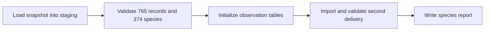

# Amazonas Wildlife Data Pipeline

An Apache Airflow 3 TaskFlow DAG that turns the existing Amazonas GBIF snapshot into a queryable SQLite database. The input is the same snapshot used by the wildlife demo. That demo builds SQLite in memory from the JSON file. This pipeline publishes a persistent SQLite file.



Airflow starts this DAG manually. Staging rejects duplicate GBIF IDs and blank species and license fields. The validation task checks both snapshot counts before publication. The first delivery initializes the published tables. The incremental import preserves existing observations and writes new rows and rejected records in one transaction. The observation table retains the original GBIF record link, license link, and rights holder.

The follow-up fixture contains ten further real GBIF records from the [GBIF Occurrence Search API](https://techdocs.gbif.org/en/openapi/v1/occurrence), three repeated rows from the initial snapshot, and one deliberately malformed synthetic row. The additional records were selected from the Amazonas search on 2026-11-17 with a CC BY 4.0 filter. The report shows added observations per species and links to the GBIF records and licenses.

| Import into a fresh database | New | Already known | Rejected |
| --- | ---: | ---: | ---: |
| First follow-up run | 10 | 3 | 1 |
| Replay of the same delivery | 0 | 13 | 1 |

- **Input:** [GBIF snapshot and provenance](data/amazon_gbif.md).
- **Output:** `output/amazonas.sqlite` with `occurrences`, `species_summary`, and `followup_rejects`. Open `output/followup_report.html` for the species report.
- **Runtime:** Keep the DAG and its sibling `data` directory on the same local Airflow installation. With separate workers, use a shared filesystem for both the input and the SQLite output. `AMAZONAS_DATABASE` overrides the output path.

Set `AIRFLOW__CORE__DAGS_FOLDER` to the absolute path of this project's `dags` directory in an Airflow 3 installation. Use the Airflow Graph view to see the dependencies. For a local Airflow test with the metadata database already initialized, run `airflow dags test amazonas_gbif 2026-11-17`.

To run just the same SQLite logic without Airflow, use `python3 dags/amazonas_gbif.py` from this directory.

```sql
SELECT observed_on, source_url, rights_holder, license_url
FROM occurrences
WHERE species = 'Panthera onca'
ORDER BY observed_on DESC, gbif_id
LIMIT 5;
```

## SQL models, Data Vault exercise and Grafana

Airflow loads the two deliveries into SQLite. A separate analytics step copies
the published observations into DuckDB, then dbt builds and tests the SQL models.
The demo extracts only the aggregate data mart into PostgreSQL for Grafana.

- `fct_observations` has one row per GBIF observation. `mart_species_month` has
  one row per scientific name and calendar month for observations with dates.
- The Data Vault exercise uses observation and species hubs, a link, and a
  date satellite. A clearly simulated correction creates a second date version
  for one observation. Version timestamps identify the demo batches and are not
  GBIF observation dates. The satellite is rebuilt from the reproducible input
  so a replay yields the same two versions. Real GBIF counts exclude the
  simulated row. The source has scientific names rather than stable taxon IDs.
- dbt validates keys, species references, and reconciles the observations and
  mart totals. Grafana queries the finished mart using a read-only user.

From the project root, with Python and Docker Compose available:

```sh
python3 -m venv .venv
source .venv/bin/activate
pip install -r analytics/requirements.txt
python dags/amazonas_gbif.py
(cd analytics && python prepare.py && dbt build --profiles-dir .)
docker compose up -d --build --wait
python analytics/publish_dashboard.py
```

Open [the local Grafana dashboard](http://127.0.0.1:3036/d/amazonas-species).
The local dashboard serves as a narrow read-only demo. Use `docker compose down`
to stop it.
